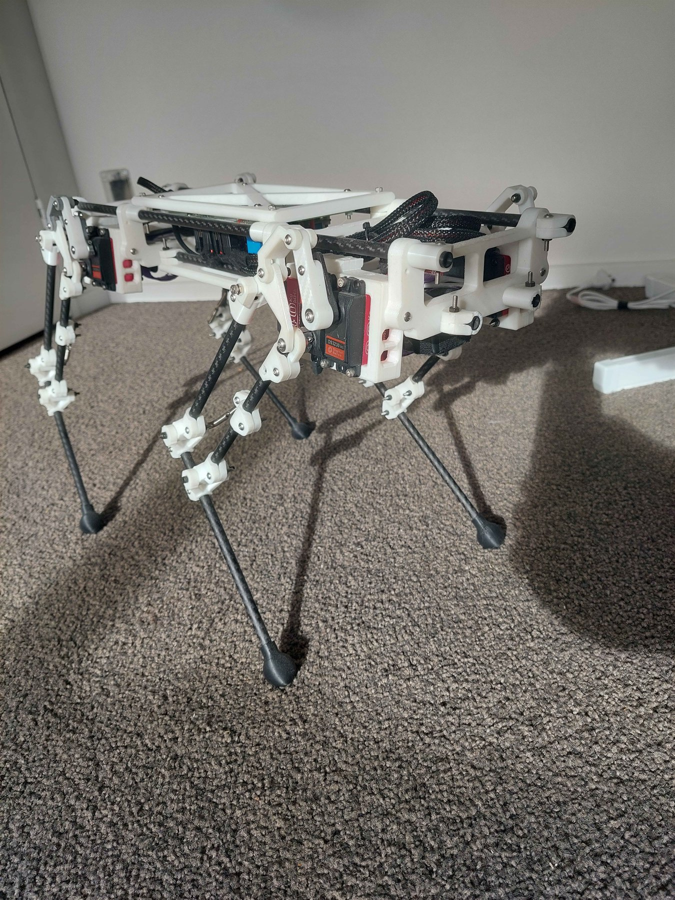
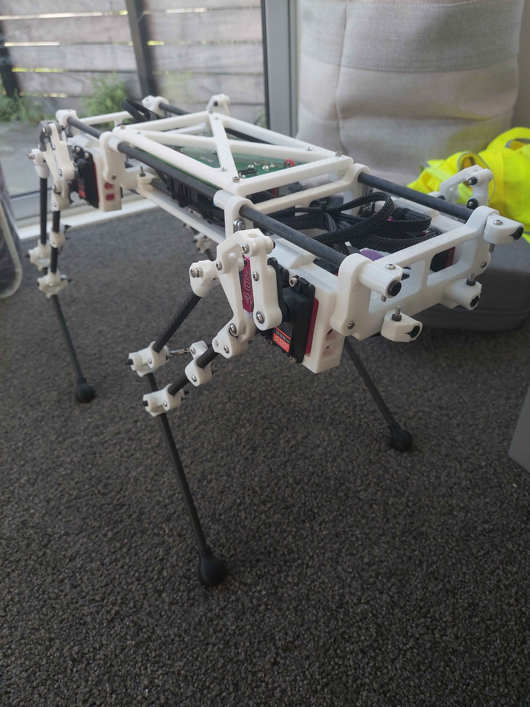
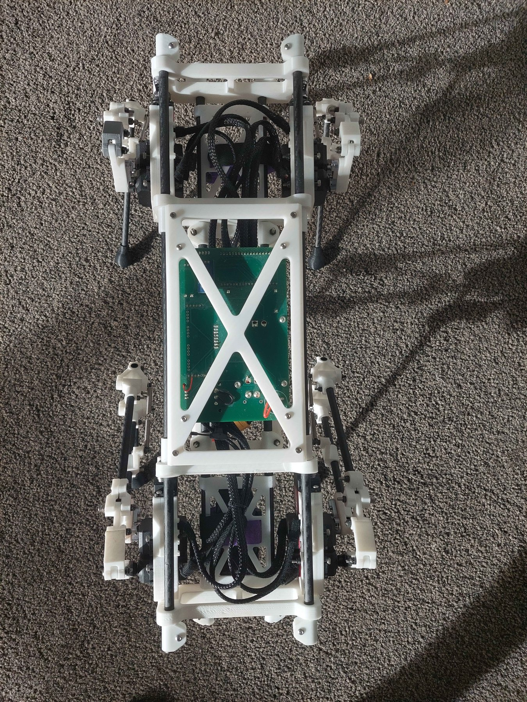
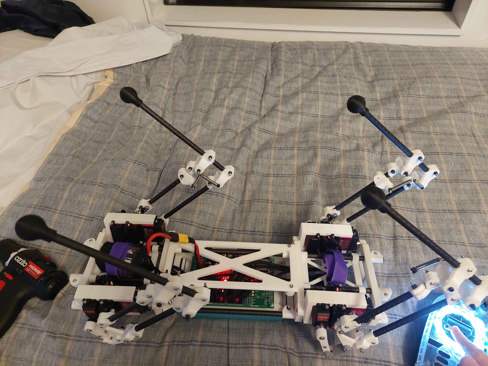
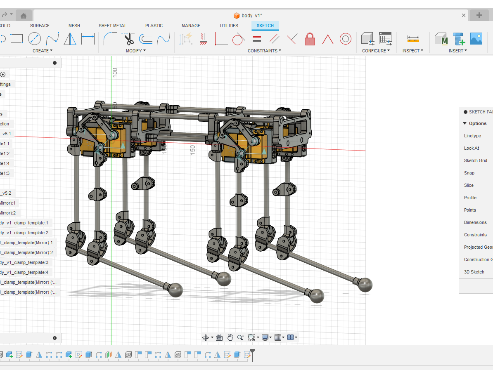
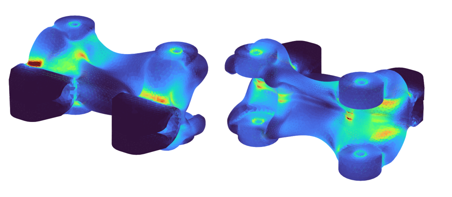
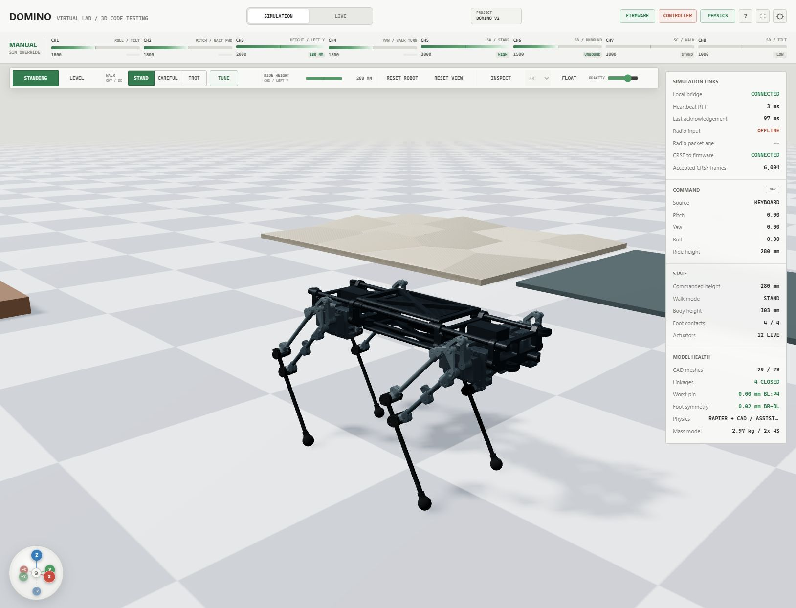
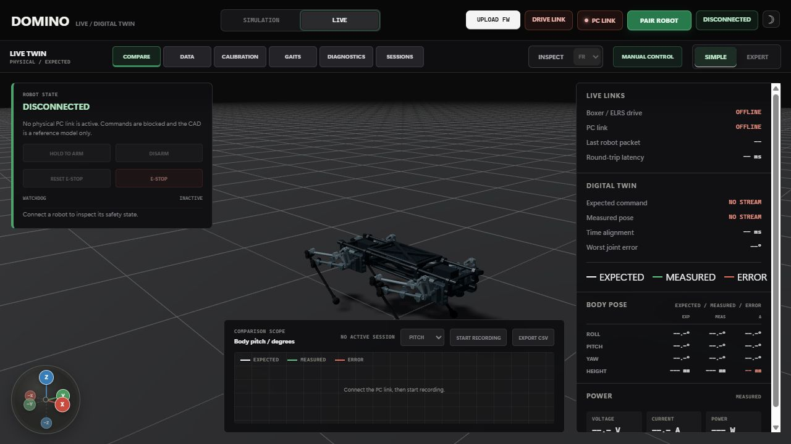
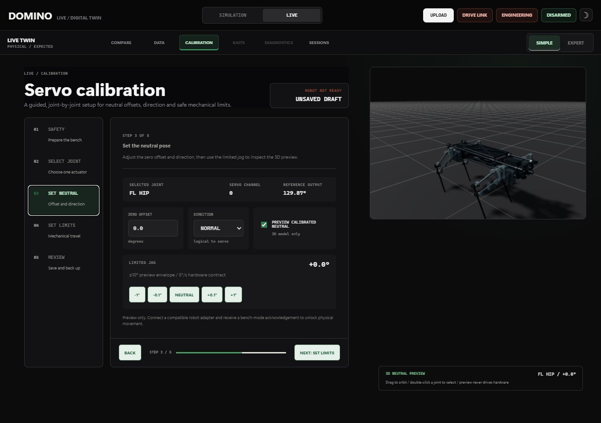

<h1 align="center">Domino</h1>

<p align="center">
  <strong>A robot dog I designed and built from scratch.</strong><br>
  Carbon-fibre legs, 3D-printed frame, 12 servos, custom PCB, and the firmware and desktop software to bring it to life.
</p>

<p align="center">
  
</p>

<p align="center">
  <a href="#the-robot">The robot</a> ·
  <a href="#what-i-designed-and-built">What I built</a> ·
  <a href="#quadruped-studio-the-software-side">Software</a> ·
  <a href="docs/engineering-overview.md">Engineering overview</a> ·
  <a href="https://github.com/Blacksheep909/Domino-ESP32-Quadruped/releases/latest"><strong>Download Studio</strong></a>
</p>

<table>
  <tr>
    <td width="33%"><br><sub><b>Front-left.</b> Printed chassis, carbon rods, 4-bar leg linkages.</sub></td>
    <td width="33%"><br><sub><b>From above.</b> Serviceable electronics cage with the custom PCB.</sub></td>
    <td width="33%"><br><sub><b>Mid-build.</b> Legs on, electronics powered up for the first time.</sub></td>
  </tr>
</table>

## The robot

Domino is a quadruped with three actuated joints per leg. Its frame is a serviceable carbon-rod-and-printed-part cage rather than a sealed shell, so every part can be reached, swapped and re-measured. It is an active prototype: it stands, adjusts height and tilt, and runs an early diagonal trot, and gait and balance tuning are ongoing.

| | |
| --- | --- |
| **Structure** | Carbon-fibre members with 3D-printed joints and a printed electronics cage |
| **Legs** | Four legs, three joints each, driven through a closed 4-bar linkage; custom inverse kinematics from the CAD geometry |
| **Actuators** | 12 high-torque 270° servos (40 kg-class shoulders, 35 kg-class leg drives) on a PCA9685 driver |
| **Brain** | ESP32 running PlatformIO / Arduino firmware |
| **Radio** | ExpressLRS receiver, with a hand-written CRSF parser on the ESP32 |
| **Power** | 4S LiPo, with an onboard buck converter, voltage and current sensing, and a servo-power relay |
| **Electronics** | Custom PCB (V1.1B Gerbers included), successor to my earlier SpotMicro Nitro board |

## What I designed and built

<table>
  <tr>
    <td width="50%"><br><sub><b>Mechanical design.</b> The full CAD model: frame, leg linkages and servo mounts. STEP, URDF and USD exports are included.</sub></td>
    <td width="50%"><br><sub><b>Custom PCB.</b> ESP32, PCA9685 servo driver, SZBK07 buck converter, relay, current sensing and receiver header on one board.</sub></td>
  </tr>
</table>

- **Mechanics.** A scratch-built layout with carbon members, printed structural parts and a service-friendly electronics cage. See the [CAD design notes](docs/cad-design.md).
- **Electronics.** A purpose-made PCB, power distribution, voltage and current sensing, and servo power isolation. See [electronics](docs/electronics.md) and the [Gerber package](hardware/pcb/domino-quadruped-pcb-v1.1b).
- **Firmware.** Per-leg kinematics for a custom linkage, a CRSF/ExpressLRS parser with link-loss handling, stand, stow, tilt and gait modes, per-servo safety limits, a watchdog and a power-fault guard. See the [engineering overview](docs/engineering-overview.md) and [control notes](docs/control-notes.md).
- **Calibration.** Every servo needs a centre, a direction and travel limits. The profile is stored in the robot's flash as a versioned, checksummed record with a backup, Studio reads it back after every save, and the robot reports where its profile came from so a robot running defaults is flagged immediately. See the [calibration guide](docs/calibration-guide.md).

### Generative knee bracket: stress analysis

<a href="cad/fea_generative_bracket"></a>

The knee bracket is a generative design printed in solid PETG. A finite-element check under Quadruped Studio's pin-reaction load cases puts the worst case at 1.78 MPa, a safety factor of about 28 within a layer and 14 across layers. See the [full analysis](cad/fea_generative_bracket), or download the [latest robot as STEP](cad/step/latest/Domino_v6_full_robot.step).

## Quadruped Studio: the software side

Commissioning twelve high-torque servos safely needs good tools, so I built **Quadruped Studio**, a Windows desktop app. It runs the real firmware kinematics against the CAD model in simulation, then connects to the physical robot for calibration, gait tuning, diagnostics and recording.

<p align="center">
  
</p>

<table>
  <tr>
    <td width="50%"><br><sub><b>LIVE.</b> Digital twin and physical-robot controls side by side.</sub></td>
    <td width="50%"><br><sub><b>Calibration.</b> Offsets, directions, limits and channel routing, previewed on the CAD model.</sub></td>
  </tr>
</table>

<p><em>Screenshots show the simulation and demo data, not a live robot connection.</em></p>

- **Simulation:** firmware modes on the actual CAD and linkage geometry, driven by keyboard, gamepad or CRSF transmitter.
- **LIVE:** telemetry graphs, gait profiles, diagnostics and saved sessions with the physical robot.
- **Safety first:** one-servo limited jog behind a bench-mode handshake, hard limits, a calibration import that stays a visible draft until the robot's readback confirms it, and a warning if the robot is running default calibration.
- **Firmware in the loop:** build and flash from inside the app, plus a software-in-the-loop executable that runs the production firmware before any hardware does.

## What this project demonstrates

Mechanical design for a closed-linkage leg, PCB design, embedded C++ firmware on the ESP32, an RF control protocol parser (CRSF), power and servo safety, calibration and persistence design, kinematics, and a full desktop engineering tool in JavaScript with 330+ automated tests plus firmware host tests.

## Get started

1. Download **Domino Quadruped Studio** from the [releases page](https://github.com/Blacksheep909/Domino-ESP32-Quadruped/releases/latest). Simulation works offline with no robot attached.
2. To drive hardware, follow the [LIVE hardware bring-up procedure](docs/live-hardware-bring-up.md) and the [calibration guide](docs/calibration-guide.md) before enabling any motion.
3. To build one, start with the [build guide](docs/build-guide.md) and the [bill of materials](docs/bill-of-materials.md). It is a prototype and not yet a finished kit; the [project overview](docs/project-overview.md#build-and-bring-up-status) lists what is and is not validated.

### Build from source

You need Node.js 20 or newer for Studio and [PlatformIO](https://platformio.org/) for the firmware.

```powershell
# Firmware: build the ESP32 image
pio run -e esp32dev

# Studio: install, test, and run the desktop app from source
cd simulation/standalone
npm install
npm test
npm run desktop:start

# Firmware software-in-the-loop check and calibration storage test
./simulation/sil/test.ps1
./simulation/sil/test-calibration-storage.ps1
```

## Documentation

| | |
| --- | --- |
| [Engineering overview](docs/engineering-overview.md) | Architecture, data flow, code tour and current boundaries |
| [Project overview](docs/project-overview.md) | Full tour: tracks, mechanics, electronics, firmware, repository layout and credits |
| [Bill of materials](docs/bill-of-materials.md) | The parts on the robot: electronics, servos, power, mechanics and the servo channel map |
| [Build guide](docs/build-guide.md) | Build sequence, wiring architecture and commissioning gates |
| [As-built record](docs/build-record-template.md) | Identity, servo routing and wiring for this robot, and what is still to record |
| [Calibration guide](docs/calibration-guide.md) | Servo centring, the LIVE wizard and how the profile is stored |
| [Quadruped Studio](docs/quadruped-studio.md) | Desktop app guide |
| [Virtual Lab](docs/virtual-lab.md) | Simulation, the seven LIVE views, connection safety and manual control |
| [Route planner](docs/route-planner.md) | Waypoints, maps, running a route, and the camera panel |
| [LIVE bring-up](docs/live-hardware-bring-up.md) | Safe procedure before physical calibration or motion |
| [Control notes](docs/control-notes.md) | Coordinate frames, IK constants, servo mapping and mode flow |
| [CRSF / ExpressLRS](docs/crsf.md) | Receiver parser and migration notes |
| [Electronics](docs/electronics.md) | Power, PCB evolution and control notes |
| [Troubleshooting](docs/troubleshooting.md) | Common faults and fixes |

## License

Released under the [MIT License](LICENSE). Third-party libraries keep their own licenses.

## Related work

Domino is the successor to my earlier [SpotMicro ESP32 Nitro fork](https://github.com/Blacksheep909/SpotMicroESP32-Nitro-Fork). See the [project overview](docs/project-overview.md#credits) for credits.
