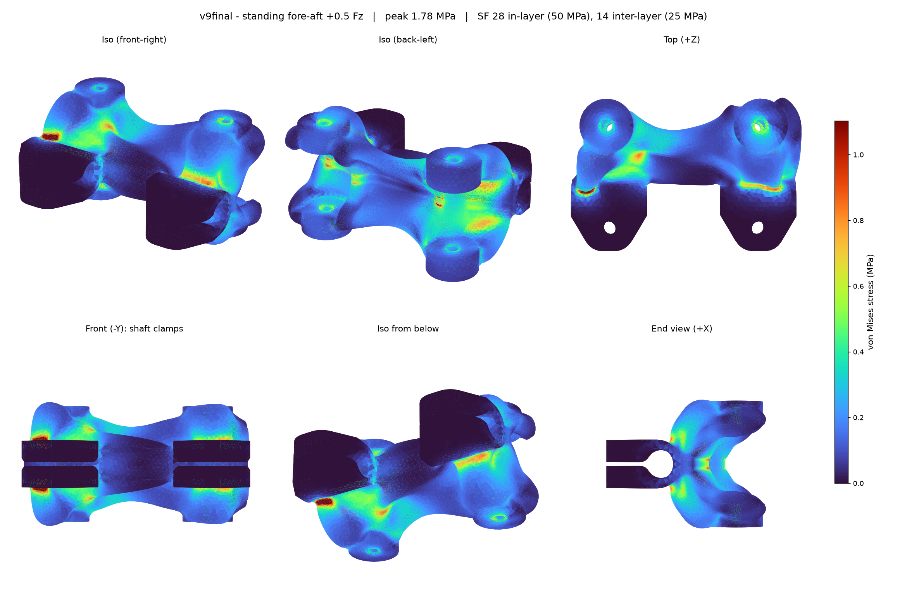

# Generative Knee Bracket: Stress Analysis

Linear static finite-element analysis of Domino's generative knee bracket (`Generative_Bracket_legv9`), printed in solid PETG. The bracket clamps onto the L3 lower-leg tube and carries the two knee linkage pins: the driven L2 pin (pad A) and the passive push-rod pin (pad B).

> These results are a design check, not a certification. Read the [limitations](#limitations) before relying on the numbers.



## Result Summary

The current bracket (`v9final`: thickened walls plus the pad-A insertion channel) peaks at **1.78 MPa** in the worst load case. That gives a safety factor of about **28 within a layer and 14 across layers**.

| Load case | Peak von Mises | Max displacement | SF in-layer (50 MPa) | SF inter-layer (25 MPa) |
| --- | --- | --- | --- | --- |
| Standing vertical | 0.81 MPa | 0.007 mm | 62 | 31 |
| 220 mm loaded crouch | 1.25 MPa | 0.009 mm | 40 | 20 |
| 300 mm loaded extension | 0.52 MPa | 0.005 mm | 97 | 49 |
| **Standing, +0.5 Fz fore-aft (worst)** | **1.78 MPa** | **0.016 mm** | **28** | **14** |
| Standing, −0.5 Fz fore-aft | 0.25 MPa | 0.002 mm | 201 | 100 |

Comparison with the original generative output (`legv8`), under the same load cases and solver:

| Load case | legv8 peak | v9final peak |
| --- | --- | --- |
| Standing vertical | 0.97 MPa | 0.81 MPa |
| 220 mm loaded crouch | 1.44 MPa | 1.25 MPa |
| 300 mm loaded extension | 0.63 MPa | 0.52 MPa |
| Standing, +0.5 Fz fore-aft | 2.14 MPa | 1.78 MPa |
| Standing, −0.5 Fz fore-aft | 0.31 MPa | 0.25 MPa |

**Where the stress goes:**
- **Hottest spot, in every case:** the inner corner where the organic body meets the pad-B shaft-clamp block. It is the dark-red patch in the "Front (−Y)" and "Iso" views.
- **Why the stresses are low overall:** the two pin reactions point in nearly opposite directions. Most of the load crosses the web between the pins, and only a small net force goes into the L3 tube.
- **What the edits did:** the seam repair, the clamp-clearance reshaping and the pad-A insertion channel all sit in low-stress regions. The 0.75 mm wall thickening lowered the peaks by about 17% compared with `legv8`.

## Load Cases

The loads come from Quadruped Studio's planar joint-load solver. The source file is [`loads/source_pin_reactions_2026-10-06.json`](loads/source_pin_reactions_2026-10-06.json), and its assumptions are:

- 2.15 kg robot with a contact factor of 3, giving 63.3 N vertical at the foot.
- Ideal planar pin joints; the diagonal is treated as a two-force member.
- Kinematic poses inside the ±45° CAD drive range.

[`loads/loadcases.json`](loads/loadcases.json) holds the per-pin reaction vectors (N, in the bracket's Y–X plane) applied in the model:

- `A`: the driven L2 pin, the solver's "right" reaction.
- `B`: the passive push-rod pin, the solver's "left" reaction.

The largest single pin load is about 280 N, on pad A in the +0.5 Fz fore-aft case.

**Boundary conditions:**
- **Fixed:** the L3 tube bore surfaces inside both shaft-clamp blocks.
- **Loads:** each pin reaction is spread as a uniform traction over that pin's bolt-hole walls in both pad halves.

## Model

| Item | Value |
| --- | --- |
| Geometry | [`geometry/v9final.step`](geometry/v9final.step), the bracket body only, as printed (20.58 cm³) |
| Baseline | [`geometry/legv8.step`](geometry/legv8.step), the original generative result |
| Mesh | gmsh, quadratic tetrahedra (P2), 1.6 mm max size with curvature refinement: 33.7k nodes, 152k tets, 712k DOF |
| Solver | scikit-fem assembly, conjugate gradient with a pyamg smoothed-aggregation preconditioner |
| Material | PETG, E = 2000 MPa, ν = 0.38, linear elastic and isotropic |
| Strength | 50 MPa in-layer and 25 MPa inter-layer; these are estimates for FDM PETG |

## Re-running

```bash
pip install -r requirements.txt
python fea.py v9final        # solve all load cases, about 25 min on a desktop CPU
python render.py v9final     # six-view close-up renders from the saved solution
```

`fea.py <tag>` reads `geometry/<tag>.step` and writes `results/<tag>/`. That output is the results JSON, a four-view plot per case and the per-element stress arrays (`*.npy`). The arrays are needed by `render.py` and are not committed, so run `fea.py` before `render.py`. To check a new bracket revision, export its body as `geometry/<newtag>.step` and run the same two commands.

The model frame is the Fusion design frame in millimetres. The pin centres, pad heights and shaft axis are constants at the top of `fea.py`, so a design that moves the pins or the shaft needs those constants updated.

## Limitations

- **Linear, static and isotropic.** Layer orientation is accounted for only through the reduced inter-layer strength. Creep, fatigue, impact and fall loads are not modelled; the 3× contact factor does not cover a crash.
- **Idealised pin contact.** Pin loads are spread evenly over each hole, so real bolt bearing will be locally several times higher around the 3.1 mm holes. Bolt preload is also not modelled.
- **Idealised fixing.** The L3 tube is treated as a perfectly rigid fixed support.
- **Print quality matters more than these numbers.** Thin walls, voids or poor layer adhesion will dominate before the stresses shown here do. Print with at least 4 walls.

## Files

```
fea_generative_bracket/
├─ fea.py                      solver
├─ render.py                   close-up renderer (uses saved results)
├─ requirements.txt
├─ geometry/                   v9final.step (current), legv8.step (baseline)
├─ loads/                      loadcases.json, source_pin_reactions_2026-10-06.json
└─ results/
   ├─ v9final/                 results JSON, solver log, 4-view and 6-view close-up plots per case
   └─ legv8/                   baseline results JSON and plots
```
