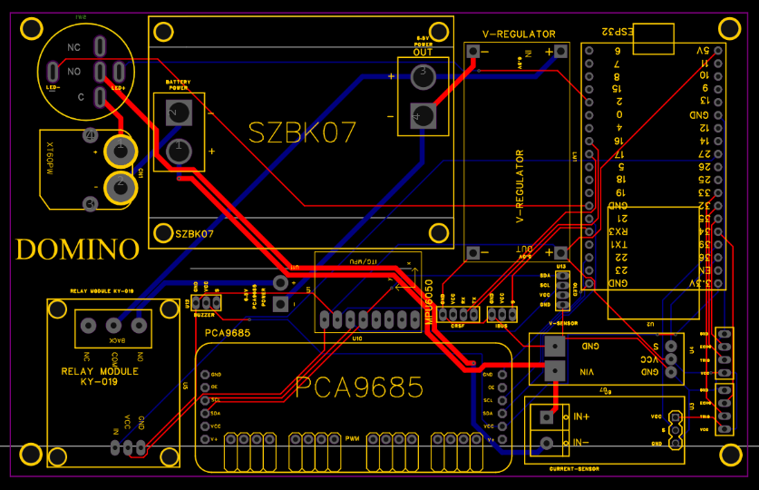

# Bill of materials

What is on the robot today. The electronics are the same family as my earlier
[SpotMicroESP32 Nitro build](https://github.com/Blacksheep909/SpotMicroESP32-Nitro-Fork), whose parts come from
Michael Kubina's [SpotMicroESP32 bill of material](https://github.com/michaelkubina/SpotMicroESP32/#bill-of-material).
Domino's own board, [PCB V1.1B](../hardware/pcb/domino-quadruped-pcb-v1.1b), is a cleaned-up
version of that layout with extra headers.

## Electronics

| Qty | Part | What it does on Domino |
| ---: | --- | --- |
| 1 | **ESP32-DevKitC** | Main controller. PlatformIO board `esp32dev`, Arduino framework. |
| 1 | **PCA9685** 16-channel 12-bit PWM driver module | Drives the 12 servos over I2C. Channels 0-4, 7-11, 14 and 15 are used; 5, 6, 12 and 13 are free. Pulses run 500-2500 µs across 270°. |
| 1 | **SZBK07** DC-DC buck converter module (20 A class) | Steps the battery down to the servo rail. |
| 1 | Logic-rail step-down module (`V-REGULATOR` footprint) | 5 V for the ESP32 and the modules, as in the SpotMicro design. |
| 1 | **0-25 V voltage sensor module** | Battery voltage on ESP32 GPIO36 (`SENSOR_VP`). Nominal 5:1 divider, calibrated in `platformio.ini`. |
| 1 | **KY-019 / HW-482** 5 V relay module | Cuts servo power completely. |
| 1 | **SpeedyBee Nano 2.4 GHz ExpressLRS receiver** (ESP8285) | CRSF link, wired to the ESP32's UART2 RX. |
| 1 | **Boxer** ExpressLRS transmitter | Radio control and the arm/disarm switch. |
| 1 | XT60PW battery connector, buzzer and LED headers | Provided by PCB V1.1B. |

Optional or not fitted on the current robot:

| Part | Status |
| --- | --- |
| **MPU6050** (GY-521) IMU | Footprint on the PCB. **Not fitted**: firmware is built with `DOMINO_IMU_ENABLED=0`. |
| **INA226** current monitor and external shunt | Supported by the firmware behind the `DOMINO_POWER_*` flags. **Not fitted**; no current or power is shown without it. |

## Actuators

| Qty | Part | Used for |
| ---: | --- | --- |
| 4 | 270° digital metal-gear servo, **40 kg-class** | Shoulders (hip joint of each leg) |
| 8 | 270° digital metal-gear servo, **35 kg-class** | Upper and lower leg drives |

## Power

| Qty | Part | Notes |
| ---: | --- | --- |
| 2 | **CNHL 1500 mAh 4S LiPo** | Treated electrically as one 4S pack. A recorded session read 14.5-15.3 V. |

## Mechanics

- Carbon-fibre rods and tubes for the frame rails and leg members.
- 3D-printed white parts: electronics cage, servo mounts, joints and clamps.
- A closed 4-bar linkage on each leg, with a spring across the linkage.
- Rounded dark feet.

The full CAD (STEP, URDF and USD) is in the repository; see the [CAD design notes](cad-design.md).

## Servo channels

| Leg | Hip | Upper | Lower |
| --- | ---: | ---: | ---: |
| Front-left (FL) | 0 | 1 | 2 |
| Front-right (FR) | 3 | 4 | 15 |
| Back-left (BL) | 14 | 7 | 8 |
| Back-right (BR) | 9 | 10 | 11 |

## Not recorded yet

Exact servo model numbers, rod diameters and lengths, fastener sizes, fuse rating,
wire gauge, and total mass. Add them to the [as-built record](build-record-template.md) as they are measured.
