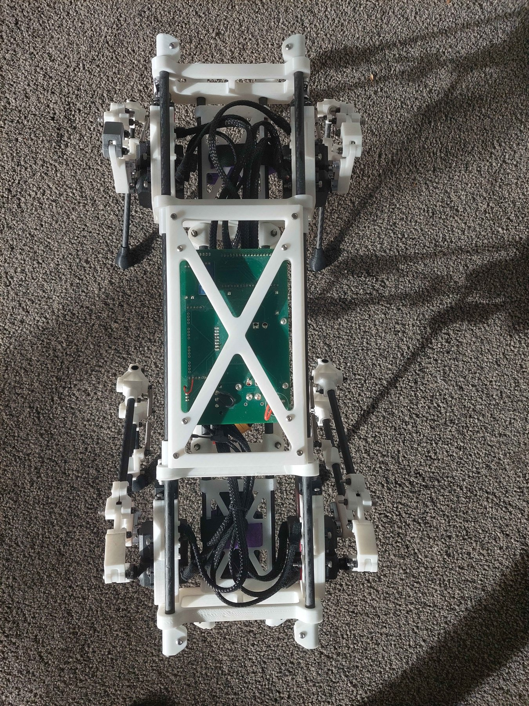
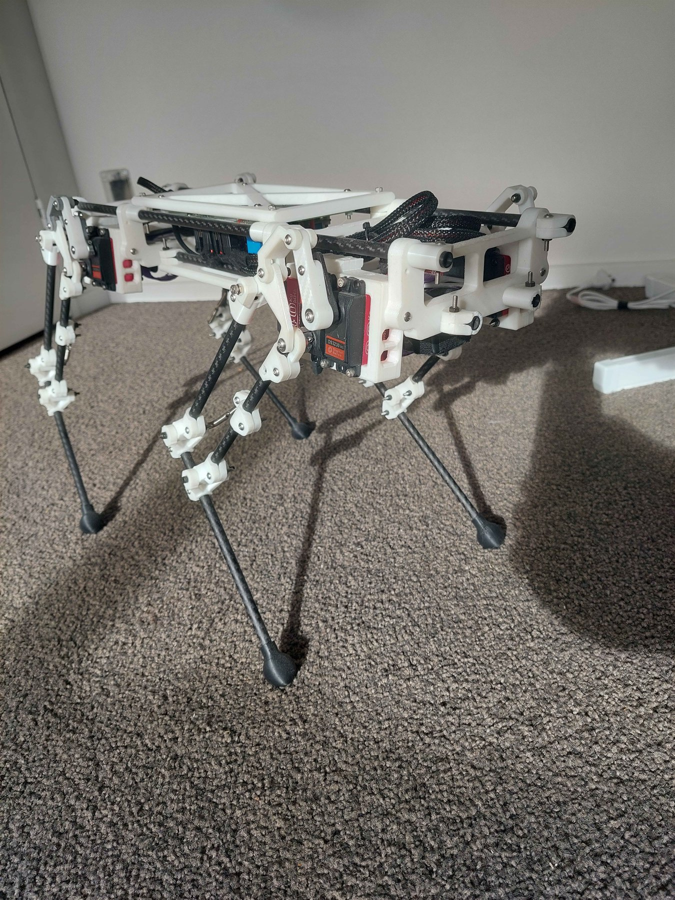

# CAD And Mechanical Design

Domino is built around a carbon-and-printed composite structure, modular 3-DoF legs, and a serviceable central electronics cage. The CAD files are included because the mechanical design is a major part of the project: firmware geometry, servo calibration, electronics packaging, and simulation work all depend on the physical layout.

> Work in progress: these CAD exports are prototype reference files. They are suitable for inspection, measurement, and adaptation, but they are not yet a complete manufacturing package. Servo fit, fastener sizes, rod lengths, print tolerances, and safe joint travel still need builder-side validation.

## Included STEP Exports

The STEP files live under [`cad/step`](../cad/step).

Download [`cad/step/latest/Domino_v6_full_robot.step`](../cad/step/latest/Domino_v6_full_robot.step) for the complete current robot (v6). The per-leg and body-frame files are listed in [`cad/README.md`](../cad/README.md). The stress analysis of the generative knee bracket is in [`cad/fea_generative_bracket`](../cad/fea_generative_bracket).

Use the individual body and leg files when checking mirrored geometry, servo orientation, linkage clearance and packaging changes.

## Design Intent

The design leaves the structure, electronics, wiring, and linkages visible and serviceable. That makes the robot easier to debug and makes the engineering decisions readable in photos, CAD views, and code review.

The body acts as an electronics spine. Printed plates and braces locate the electronics bay and leg modules, while carbon members carry longer span loads without making the body bulky.

Each leg module provides:

- Hip abduction/adduction.
- Upper-leg pitch.
- Lower linkage / knee motion.

The lower mechanism is closer to a closed-chain/four-bar linkage than a simple serial arm. That affects the whole project: the CAD must provide clearance, the firmware must use the effective leg geometry, and simulation must either approximate or explicitly constrain the closed loop.

## Composite Cage Structure

The central chassis can be treated as a composite cage:

- Printed parts define mounting surfaces, pivots, and electronics placement.
- Carbon rods/tubes provide stiffness across longer spans.
- The PCB, receiver, regulator, and servo harnessing remain accessible.
- Leg motion remains the dominant packaging constraint rather than body width.
- Body, leg, electronics, and carbon-member changes can be iterated separately.

This modularity is why the repo includes separate body and corner-leg STEP files instead of only a single monolithic assembly.

## Firmware Relationship

CAD changes can affect firmware behavior. Changes to link length, servo horn clocking, pivot location, or body width may require updates to:

- IK reachability in [`src/ik.cpp`](../src/ik.cpp).
- Servo direction and trim values in [`src/leg_controller.cpp`](../src/leg_controller.cpp).
- Per-servo safety limits.
- Stand, stow, ride-height, and tilt poses in [`src/main.cpp`](../src/main.cpp).

After a mechanical change, repeat the bring-up and calibration process. Do not assume the existing trim values or safety limits still protect the mechanism.

## Simulation Models

Two simulation models are built from this CAD:

- Quadruped Studio renders the meshes under [`simulation/urdf/generated`](../simulation/urdf/generated) and solves the closed leg linkage itself.
- The Isaac Lab training model in [`simulation/isaac_lab`](../simulation/isaac_lab) treats each leg as a serial hip / thigh / knee chain. The leg is a parallelogram, so this gives the same foot position without closed-loop constraints.

Re-export both after a CAD change; the steps are in the [Isaac Lab README](../simulation/isaac_lab/README.md).
