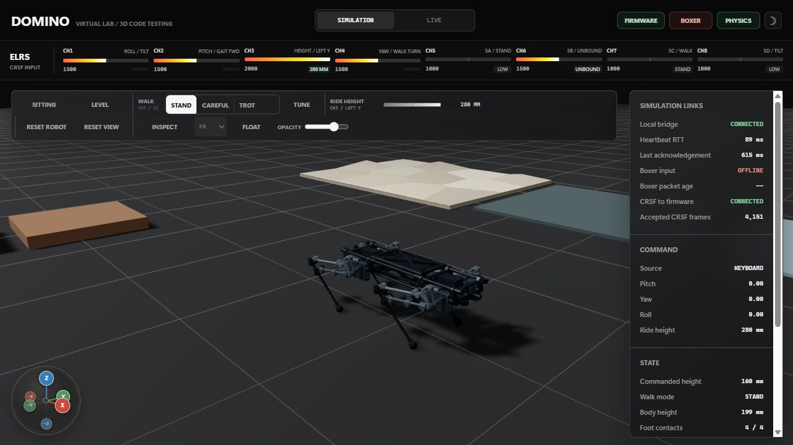
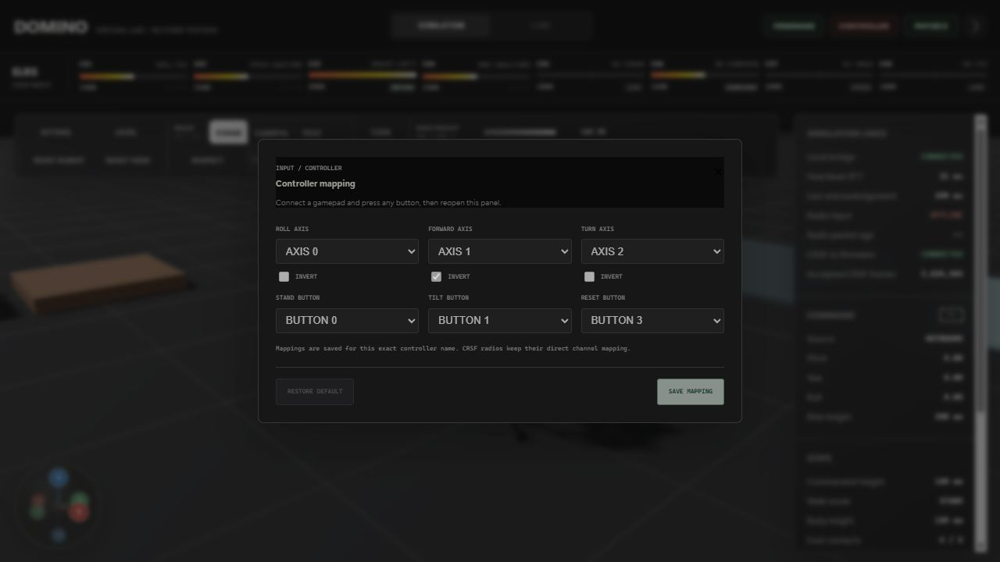
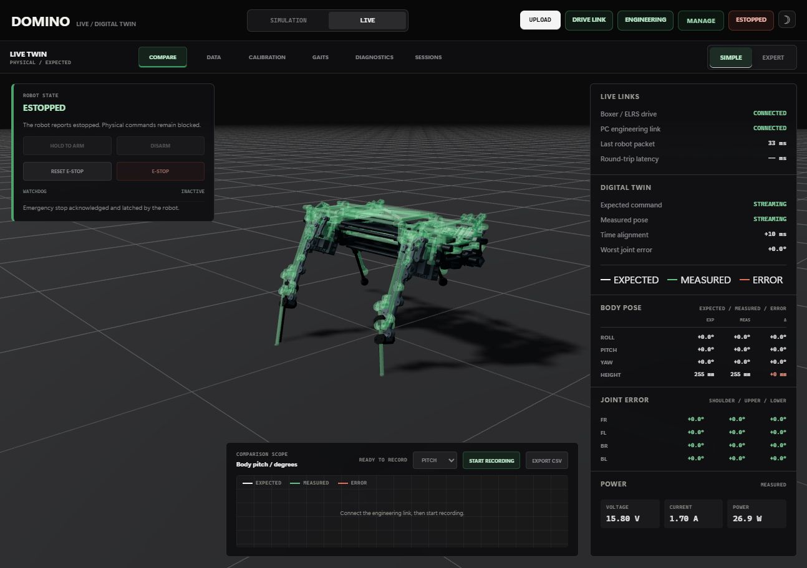
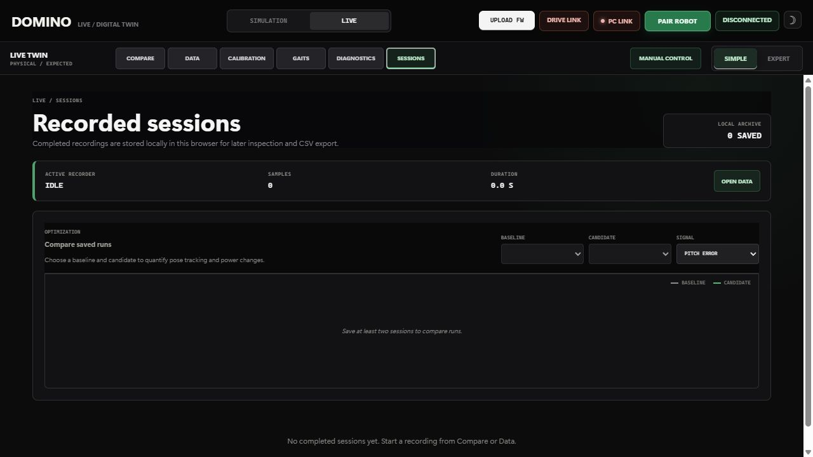
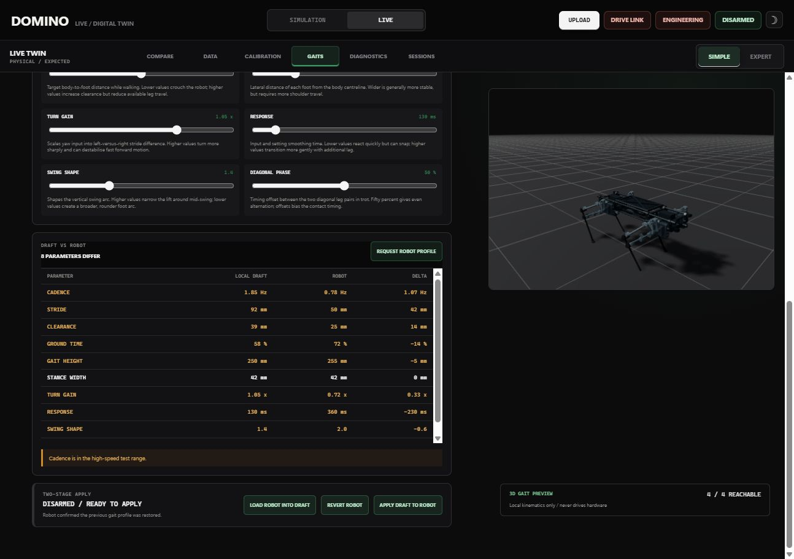
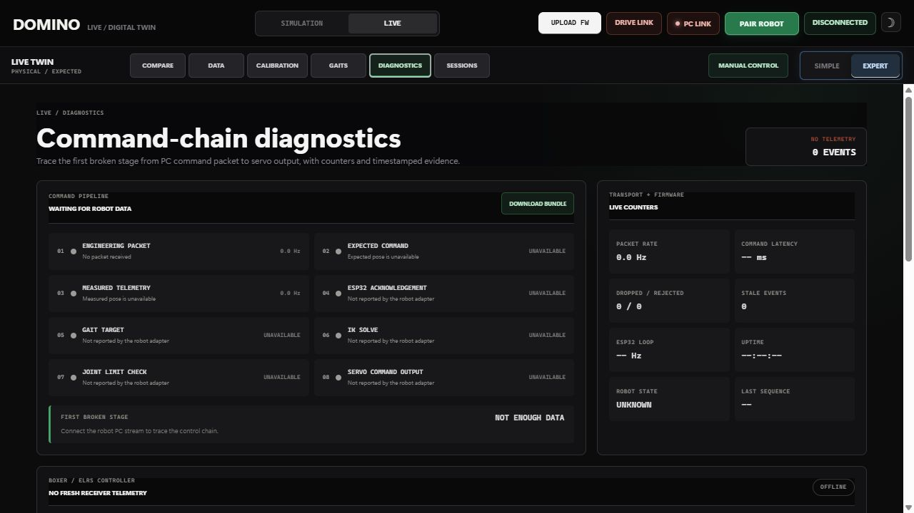
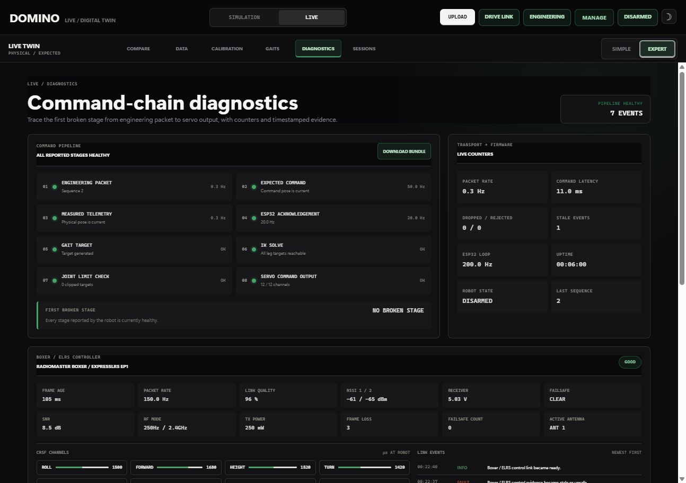

# Domino Virtual Lab

The Virtual Lab is Studio's engineering workspace: a **Simulation** side for trying
things safely and a **LIVE** side for the physical robot. For installation and a
first-use walkthrough, start with the [Quadruped Studio guide](quadruped-studio.md).



| | Simulation | LIVE |
| --- | --- | --- |
| Talks to | The firmware compiled as a native program, the CAD, and Rapier physics | The physical robot, through a companion adapter |
| Starts | Always the first page on launch | Disarmed, read-only |
| Use it for | Gait experiments, joint inspection, controller mapping | Calibration, gait profiles, telemetry, diagnostics, recording |

## Simulation

- Runs the **production control firmware** as a native process against the real CAD and a closed-linkage solver.
- Inputs: keyboard, configurable gamepads, or a CRSF transmitter.
- Its link indicators describe only the local simulation bridge, never the physical dog.
- Each indicator is independent: bridge heartbeat, radio (fresh transmitter HID packets only), and CRSF (from the simulated firmware). Keyboard or gamepad input cannot make the radio light appear connected.
- **MAP** stores axes, inversion, buttons, deadzone and response curve per exact controller. Xbox, DualShock 4, DualSense and standard generic pads are recognised by name. A live trace shows raw input, shaped input and the resulting command. CRSF radios bypass mapping.



## LIVE views


| View | What it does |
| --- | --- |
| **Compare** | Digital twin: expected pose, measured pose (a translucent overlay), body-pose deltas, 12 joint errors, power, and a synchronized scope |
| **Data** | Large signal graph, recorder, live metrics, and a table of synchronized samples |
| **Sessions** | Local archive of the 20 newest recordings; CSV or JSON export, import, and baseline-versus-candidate comparison |
| **Calibration** | Guided five-step servo calibration; see the [calibration guide](calibration-guide.md) |
| **Gaits** | Gait profile editor with a 3D preview, robot comparison and an apply/rollback path |
| **Diagnostics** | Eight-stage command-chain trace, packet and loop stats, CRSF/ELRS link health, and a downloadable bundle |
| **Sensors** | GPS, LiDAR, camera and the [route planner](route-planner.md) |

The top bar always shows battery voltage, arm state, the PC and drive links, and the E-stop.
Measured values stay **unavailable** until the robot sends them; they never borrow simulated data.

## Connecting and safety

- **Pairing.** The connection manager discovers adapters, shows identity, firmware, signal, endpoint and capabilities, then negotiates a **read-only** session. Connecting never arms or moves the robot.
- **Session binding.** Telemetry, calibration and gait traffic is tied to the selected adapter and session. Stale adapters, mismatched packets and unsolicited acknowledgements are rejected. Losing the bridge or the adapter heartbeat relocks all hardware commands.
- **Reconnect.** After an interruption LIVE retries only the read-only handshake, with 1-10 s backoff. `CANCEL RETRY` forgets the target. A rejected or failed handshake enters a `FAULT` phase; `CLEAR FAULT` clears only the PC-side record. `RESTART USB` reopens the physical link and keeps commands locked.
- **Arming.** Needs a continuous 1.5 s hold with the PC link, both telemetry streams and the CRSF drive link all fresh. Arm, disarm, E-stop and reset wait for a robot acknowledgement; the UI never updates optimistically.
- **Watchdog.** While armed the browser sends a 10 Hz heartbeat and needs acknowledgements within 400 ms. Hiding the tab, leaving LIVE or losing a link stops it, and the robot must disable outputs on its own.
- **Low-voltage fault** (with a calibrated INA226): at or below 12.8 V for 750 ms the robot disables every output and blocks re-arming until power telemetry recovers to 13.6 V. Both are build-time placeholders to replace with real pack limits.
- **Drive link.** Needs fresh `crsf-radio` telemetry, failsafe clear, link quality of at least 50%, and RSSI no worse than -105 dBm.
- **Physical E-stop** remains the primary power isolation.



## Manual control

The toolbar offers guarded browser control alongside the radio.

| Rule | Value |
| --- | --- |
| Authority | A robot-granted, session-bound lease, 30 s maximum |
| Transmit rate | 20 Hz, only while **HOLD TO DRIVE** is held |
| Robot-side timeout | 250 ms, then neutral |
| Revoked by | Release, hidden tab, leaving LIVE, disarm, lost adapter, watchdog or lease expiry |
| Stand (Expert) | Roll and pitch ±8°, yaw ±8°, fore/aft ±15 mm, lateral ±12 mm, ride height |

Locomotion turn is a separate axis, so rotating the standing body can't be confused with steering a gait.
The expected 3D pose follows robot-reported telemetry, not the sliders, so you see what the robot accepted.

## Recording and sessions

- The scope graphs body pose, battery voltage/current/power, commanded foot Z, any of the 12 joint angles, and each calibrated PWM command. Series appear only when their source exists; there are no encoders, so joints are command-only.
- Telemetry gaps show as gaps. Windows of 10, 30 or 60 s, or the full session; exports keep every raw sample.
- Export as CSV or as a versioned JSON package; the Sessions page validates and imports it. Without durable storage the page says `MEMORY ONLY`.
- Comparing two runs reports mean pitch error, P95 joint error, average power, energy, minimum voltage and peak current.



## Calibration

A five-step wizard: bench safety, select joints, neutral and direction, limits, review. Physical movement and saving are locked until the robot acknowledges bench mode, jogging of at most 5°/s, and profile storage. The preview is a floating CAD model; the channel-map editor can route any joint to any PCA9685 output 0-15, with duplicate checks and explicit confirmations. Full details in the [calibration guide](calibration-guide.md).


## Gaits

- Shares the profile library and JSON format with the Simulation gait lab. Edits stay a local draft until you apply them.
- Apply needs persistent-profile support and a disarmed robot. The robot validates all bounds with outputs off, writes the inactive flash slot, reads it back and checksums it, then switches slots. The previous slot stays available for rollback.
- Expert mode adds neutral touchdown X and the maximum forward and turn command scales.
- A per-leg IK inspector reports target, validity, delta, stance or swing, and actuator-envelope contact. **Apply Draft** stays disabled until a fresh four-leg preview is reachable and unclipped.



## Diagnostics

- Traces PC packet, expected and measured pose, ESP32 acknowledgement, gait target, IK, limit check and the 12 servo outputs; the first fault is called out.
- Reports packet rate, latency, missing/rejected/stale counts, loop rate, uptime and state.
- Controller panel: CRSF frame age and rate, link quality, RSSI, receiver voltage and failsafe; Expert adds all 16 channels, SNR, RF mode, power and antenna.
- **Inspect** shows the final calibrated pulse in µs and its PCA9685 output for any joint. These are commands, not measurements.




## Preferences

Theme, panel layout, Simple/Expert detail, the last LIVE tool and the calibration float setting are saved locally and fall back to safe defaults if damaged. A reload always opens Simulation and never restores connection, arming, bench mode, manual authority or telemetry.

## Architecture

1. The **browser** renders the UI, CAD and physics.
2. A **local Node server** owns HID input, command arbitration, session logs, and firmware build and upload.
3. The **SIL executable** runs the same C++ controller as the ESP32.

The robot has two independent wireless paths: ExpressLRS/CRSF for driving, essential telemetry and stop, and ESP32 Wi-Fi for engineering telemetry, calibration, profiles and logs. Bluetooth and USB are reserved for setup and bench use. All transports carry the same session-bound envelopes. The companion protocol is in [LIVE companion protocol](live-companion-protocol.md).

## Run from source

```powershell
cd simulation\standalone
pnpm install
cd ..\..
pio pkg install --global --tool platformio/toolchain-gccmingw32
.\simulation\sil\build.ps1
cd simulation\standalone
pnpm run desktop:start
```

Tests: `cd simulation\standalone; pnpm test`. `dist/`, `node_modules/` and `runtime/` are ignored.
